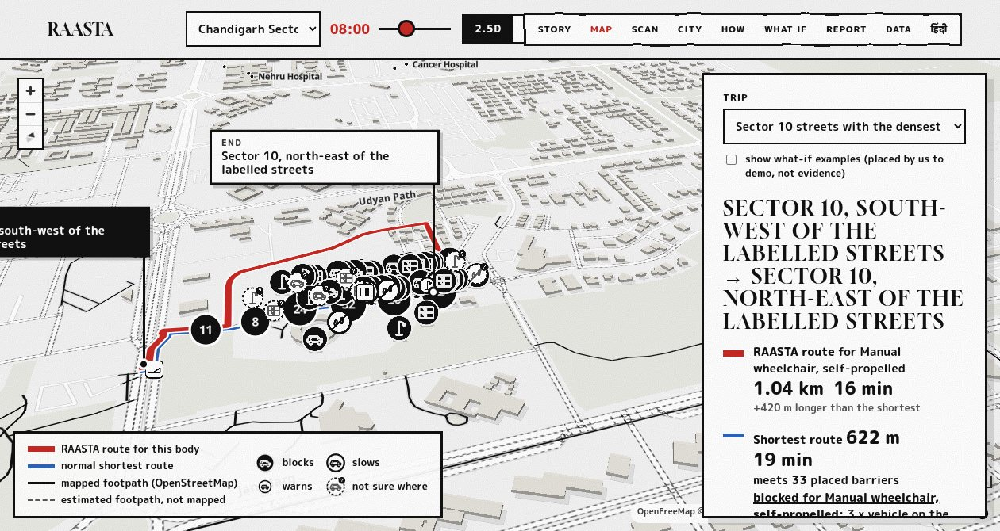
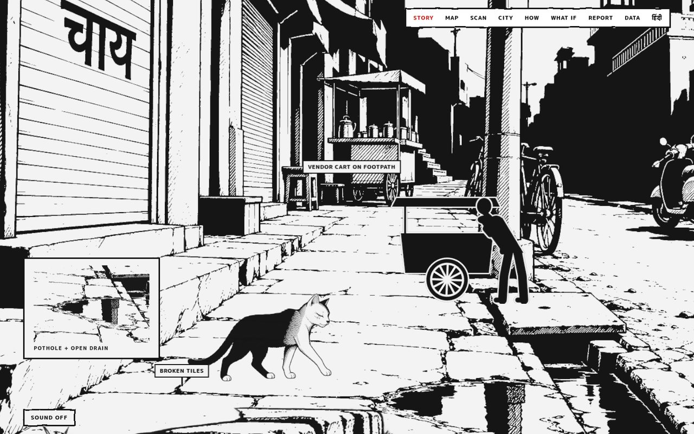
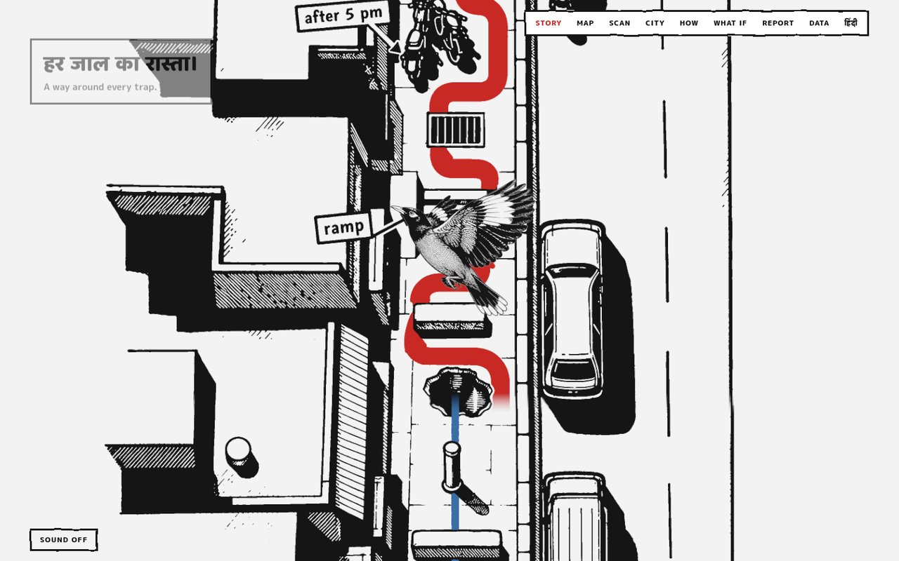
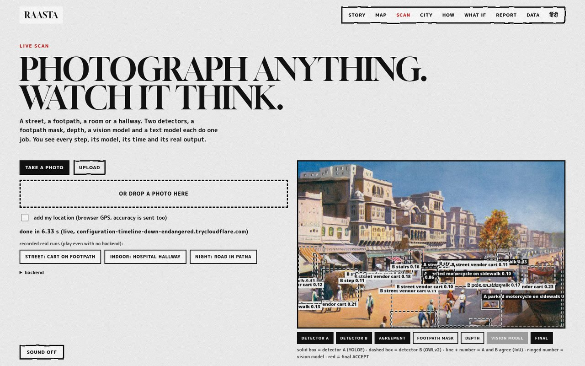

# RAASTA

**The route that does not exist for your body.**

RAASTA turns any Indian street photo into a per-body accessibility verdict, and a walking route that avoids the things that actually stop you: a 150 mm kerb with no ramp, a parked cart on the footpath, a broken slab, a pole in the middle of the path.

Built for **HYPNEXIS '26**, problem statement **SC-02: Accessible Walking Routes from Street Imagery**, by **Team RISC**, Manipal University Jaipur.

[](https://harshgounder.github.io/raasta/)
[](#the-problem-statement)
[](LICENSE)

**Live site:** https://harshgounder.github.io/raasta/  
**QR:** scan `docs/img/demo-qr.png`

> The live site runs on the demo laptop. The site and static pages come from a tunnel, the scan and report backends run locally. If the tunnel is down, the site runs offline with one command, see [Run it locally](#run-it-locally).



## What it does

- **Scan a street photo.** Upload any street, footpath, room or hallway. Twelve stages run in front of you: two detectors, agreement, footpath mask, depth, measurement, placement, impact, a vision model, a reasoner, and a receipt. Detectors run in about 6 s; the full scan with vision and reasoner runs in about 26 s on a 4 GB laptop GPU.
- **Pick a body, not a setting.** 74 body profiles across 7 categories, 25 subcategories. The same kerb is a different cost for a manual wheelchair, a walker, a white cane, a person carrying a load, or a person with low vision.
- **See the route that avoids it.** Shortest route versus RAASTA route, on a 2.5D footpath map, with the barriers each route meets. On the Chandigarh demo: the shortest route is 622 m and meets 33 placed barriers. The RAASTA route is 1.04 km and meets 0.
- **Never call a segment safe.** Every segment is `known_barrier`, `known_clear` with a date, `osm_tag`, or `unknown`. Routes report those counts. No recent image means unknown, not safe.
- **Report a barrier in under a minute.** A photo and a place, GPS or picked on the map. It is recorded at once, an AI takes a first look, a person checks it, and routes change after that. Status trail with human check and answer dates.
- **Ask what if.** 300 questions across 12 topics, each runnable on the map instead of a static FAQ.

## Open the site, page by page

| page | what it shows | link |
|---|---|---|
| story | one street, one camera, a cat, three people, the same kerbs | [/](https://harshgounder.github.io/raasta/) |
| map | 2.5D footpath network, per-body routes, barrier cards with photo evidence | [/map/](https://harshgounder.github.io/raasta/map/) |
| scan | live photo scan, every model and every stage visible | [/scan/](https://harshgounder.github.io/raasta/scan/) |
| city | what is measured, what is not, per city | [/city/](https://harshgounder.github.io/raasta/city/) |
| how | the anatomy of the pipeline, 17 stages | [/how/](https://harshgounder.github.io/raasta/how/) |
| what if | 300 questions, 12 topics, runnable on the map | [/what-if/](https://harshgounder.github.io/raasta/what-if/) |
| report | barrier report, status trail, complaint letter | [/report/](https://harshgounder.github.io/raasta/report/) |
| data | every source, licence and count | [/data/](https://harshgounder.github.io/raasta/data/) |





## The problem statement

SC-02 asks for a system that detects accessibility barriers in street-level images, maps every detection to the correct footpath segment, and plans routes that avoid them. It also says teams must label their own local images, because Project Sidewalk's labels come from other countries.

What we did about each clause:

| clause | what we show |
|---|---|
| detect barriers in street images | two detectors plus agreement plus a receipt: YOLOE-11s-seg and OWLv2, IoU 0.30, every stage timed |
| five required barrier classes | missing kerb ramp, steps, broken or missing footpath, pole, parked vehicle, plus Indian extras |
| map detections to segments | placement at 0.7 probability or **ABSTAIN**, with candidate segments, never a forced pin |
| footpath network | OSM footways plus generated sidewalk segments where India has no footway geometry |
| route around barriers | per-body cost model, shortest versus accessible, conditions for time, weather and streetlight |
| label our own Indian images | 100 Indian images labelled, score published: micro F1 0.23 with a high abstain rate, said out loud |

## How it works

```
photo / OSM / labels
      |
      v
 intake -------- EXIF time, GPS, weather bin, blur, haze
      |
      v
 detect -------- YOLOE-11s-seg (A) + OWLv2 (B), agreement at IoU 0.30
      |
      v
 measure ------- SegFormer sidewalk mask + Depth Anything V2, kerb height in mm
      |
      v
 place --------- match to an OSM segment, 0.7 threshold, else ABSTAIN
      |
      v
 score --------- element x body matrix, 28,046 cells, 46 combination rules
      |
      v
 route --------- shortest vs accessible, 74 bodies x 5 conditions, 3,700 routes
      |
      v
 explain ------- receipt with model, time, evidence age, uncertainty
```

The taxonomy is per body, not one accessibility score. 379 elements in 12 categories and 31 subcategories meet 74 bodies in 7 categories and 25 subcategories. The impact engine has 8 scoring functions, 46 combination rules, 22 of them compound rules, and a 28,046 cell matrix.

## What is real and what is assumed

Honesty is part of the product, so it is part of this README.

| number | status |
|---|---|
| 74 bodies, 379 elements, 46 rules, 28,046 cells | built and tested, 74/74 engine tests |
| 3,700 routes | precomputed: 10 trips x 74 bodies x 5 conditions |
| Chandigarh: 198 barriers, 155 ACCEPT, 43 ABSTAIN | placed from Project Sidewalk labels, CC0 |
| 3 cities, 4 networks | Jaipur 4,537 segments, Jaipur photos 4,704, Chandigarh 7,047, Varanasi 4,279 |
| 327 licensed images | in the licence ledger with source and licence |
| 100 labelled Indian images, micro F1 0.23 | published as is, AI-assisted, 20 images still need a human pass |
| 86% of element impact values | routing assumptions, marked in the app |
| Jaipur barriers observed | 0. 130 detections abstained instead of being forced onto a segment |
| scan time | detectors about 6 s, full scan with both models about 26 s, measured |

We would rather print a weak number and its caveat than a strong number we cannot defend.

## Run it locally

The site is static and needs no backend for the story, map, city, how, what if and data pages. Scan and report need their services.

```bash
# site
cd app/site
npm install
npm run dev            # http://127.0.0.1:5173

# routing API (port 8020)
cd app/route
uv venv .venv
uv pip install --python .venv osmnx networkx shapely pyproj fastapi uvicorn numpy scipy pytest httpx matplotlib
.venv/bin/uvicorn hroute.api:app --port 8020

# reports service (port 8790), SQLite on disk
cd app/reports
./run.sh

# scan backend (port 8010), needs model weights, see app/analyze/LIVE-SCAN.md
cd app/analyze
.venv/bin/uvicorn server:app --port 8010
```

Point the site at the services with `app/site/public/config.js` or the `?api=` and `?reports=` query parameters. Model weights are not in this repo; `app/analyze/LIVE-SCAN.md` lists them.

## Repo layout

```
app/site        the 8 page site, story engine, map, scan UI, report UI
app/route       footpath network, placement, cost model, routing API, taxonomy
app/analyze     detectors, measurement, scan pipeline, receipts
app/reports     report service, status trail, AI triage with rule fallback
app/site/public art, audio, fonts, content JSON
data/labels     our labelled Indian test set (C6)
docs            scan pipeline, footpath network, routing, impact engine
research        the source research, markdown only
method          selection and ideation methods used to pick SC-02
story           story specification and motion notes
```

## Data and licences

- OpenStreetMap, ODbL 1.0. Generated sidewalks are derived from OSM.
- Project Sidewalk, CC0. Chandigarh deployment labels.
- Mapillary, CC BY-SA 4.0. Wikimedia Commons for the rest.
- Fonts under the SIL Open Font Licence. Full texts ship with the site.
- The code in this repository is MIT, see [LICENSE](LICENSE). Data keeps its own licence.

Every row and every count is on the live [/data](https://harshgounder.github.io/raasta/data/) page.

## Team

**Team RISC**, Manipal University Jaipur, HYPNEXIS '26.  
Harsh Gounder, Farhan Fidin, Shlok Srivastava, Shivam Dureja.

Built with a four agent fleet (Claude, Codex, Hermes, DSH), a shared message bus, and a rule that every claim needs a second engine or a file on disk.

## Contact

Open an issue on this repo, or use the report page on the live site.
